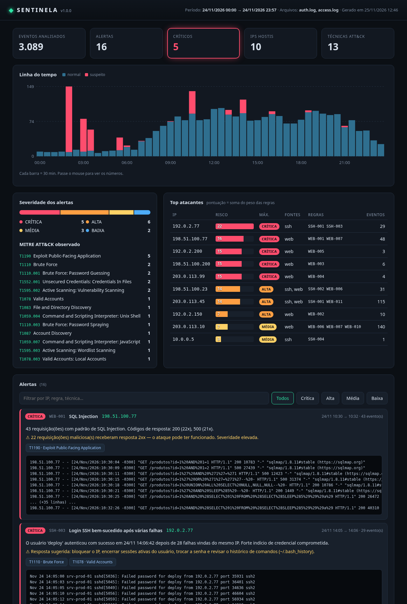
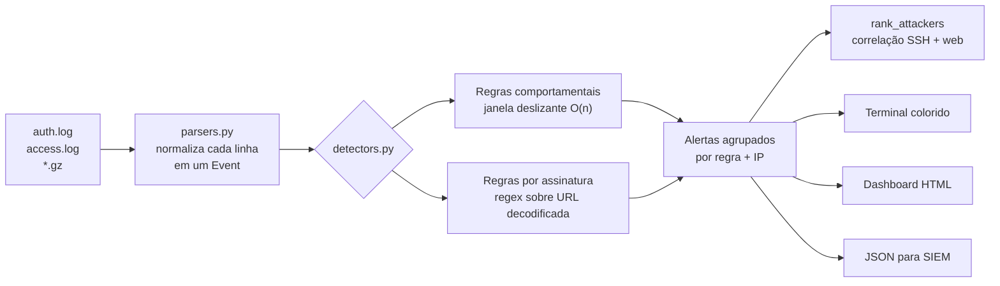

<div align="center">

# ◆ Sentinela

**Detector de ataques em logs de SSH e servidores web, com mapeamento para o MITRE ATT&CK.**

[](https://github.com/Duuttra/sentinela/actions)




</div>

---

## O problema

Todo servidor exposto na internet é atacado o tempo todo: robôs testando senhas no SSH, scanners
procurando `.env` esquecido, sqlmap martelando parâmetros. As evidências ficam nos logs, mas
ninguém lê milhares de linhas de `auth.log` e `access.log` por dia.

O **Sentinela** lê esses logs, separa o ruído do que importa e entrega ao analista **o que
aconteceu, quem fez, se funcionou e o que fazer**, com cada achado mapeado para uma técnica do
[MITRE ATT&CK](https://attack.mitre.org/).

## Destaques

- **13 regras de detecção** para SSH e web: força bruta, password spraying, SQLi, XSS, path traversal,
  injeção de comandos, Log4Shell, varredura de diretórios e outras.
- **Detecção de comprometimento:** um login SSH aceito depois de várias falhas vira alerta **CRÍTICO**,
  porque significa que a força bruta funcionou.
- **Ataque que deu certo pesa mais:** se a requisição maliciosa recebeu `HTTP 2xx`, a severidade sobe
  um nível.
- **Correlação entre fontes:** o mesmo IP atacando SSH e web aparece no ranking de atacantes com uma
  pontuação de risco única.
- **Dashboard HTML** autocontido (um único arquivo, sem nada externo), com linha do tempo, ranking de
  IPs, técnicas ATT&CK e evidências filtráveis.
- **JSON** para alimentar SIEM, SOAR ou scripts.
- **Tempo real:** `sentinela monitorar` acompanha os logs como um `tail -f` e emite alertas na hora.
- **Integração com CI e cron:** `--falhar-em alta` retorna o código de saída 1 quando aparece algo grave.
- **Zero dependências:** só a biblioteca padrão do Python. Roda em qualquer servidor.
- **Seguro contra o próprio log:** logs de ataque são entrada hostil. O HTML escapa payloads XSS, o
  terminal neutraliza sequências de escape ANSI e as regex resistem a ReDoS, tudo coberto por testes
  (veja o [modelo de ameaça](SECURITY.md)).

## Início rápido

```bash
git clone https://github.com/Duuttra/sentinela.git
cd sentinela
python3 -m sentinela demo        # gera logs com um cenário de ataque e analisa
xdg-open sentinela-demo/relatorio.html
```

O `demo` simula um dia de um e-commerce: cerca de 2.900 requisições legítimas, logins dos admins
(incluindo erros de digitação, que **não** devem gerar alerta) e 11 ataques distintos. Os IPs
atacantes usam as faixas reservadas para documentação (RFC 5737), então nenhum IP real é acusado.

## Uso

```bash
# instalar como comando (opcional)
pip install .

# analisar logs reais (aceita vários arquivos, inclusive .gz do logrotate)
sudo sentinela analisar /var/log/auth.log /var/log/nginx/access.log* \
     --html relatorio.html --json relatorio.json

# só o que for ALTA ou CRÍTICA
sentinela analisar /var/log/auth.log --severidade-minima alta

# monitorar em tempo real
sudo sentinela monitorar /var/log/auth.log /var/log/nginx/access.log

# ajustar sensibilidade
sentinela analisar auth.log --limiar-forca-bruta 5 --janela-forca-bruta 120

# em cron/CI: código de saída 1 se houver alerta ALTA ou pior
sentinela analisar auth.log --falhar-em alta || enviar-alerta.sh
```

<details>
<summary>Exemplo de saída no terminal</summary>

```
 CRÍTICA  SSH-003 Login SSH bem-sucedido após várias falhas — 192.0.2.77 (29 evento(s), 24/11 14:05)
          O usuário 'deploy' autenticou com sucesso em 24/11 14:06:42 depois de 28 falhas vindas
          do mesmo IP. Forte indício de credencial comprometida.
          ⚠ Resposta sugerida: bloquear o IP, encerrar sessões ativas do usuário, trocar a senha
            e revisar o histórico de comandos (~/.bash_history).
          MITRE ATT&CK: T1110 Brute Force, T1078 Valid Accounts

 CRÍTICA  WEB-003 Path traversal / Local File Inclusion — 198.51.100.200 (6 evento(s), 24/11 16:20)
          6 requisição(ões) com padrão de Path traversal / Local File Inclusion. Códigos de resposta: 403 (4x), 200 (2x).
          ⚠ 2 requisição(ões) maliciosa(s) receberam resposta 2xx — o ataque pode ter funcionado.
          MITRE ATT&CK: T1190 Exploit Public-Facing Application, T1083 File and Directory Discovery

  TOP ATACANTES
   CRÍTICA  192.0.2.77         risco  22  ssh      SSH-001 SSH-003
   CRÍTICA  198.51.100.77      risco  16  web      WEB-001 WEB-007
   ALTA     203.0.113.45       risco  14  ssh,web  SSH-001 WEB-011
   ...
```
</details>

## Regras de detecção

| ID | Detecção | Como funciona | Severidade | MITRE ATT&CK |
|----|----------|---------------|-----------|--------------|
| SSH-001 | Força bruta SSH | ≥ 10 falhas do mesmo IP em 5 min (janela deslizante) | Alta | [T1110.001](https://attack.mitre.org/techniques/T1110/001/) |
| SSH-002 | Password spraying / enumeração | ≥ 5 usuários distintos testados pelo mesmo IP | Alta | [T1110.003](https://attack.mitre.org/techniques/T1110/003/), [T1087](https://attack.mitre.org/techniques/T1087/) |
| SSH-003 | **Login após falhas** | Login aceito depois de ≥ 3 falhas do mesmo IP na última hora | **Crítica** | [T1110](https://attack.mitre.org/techniques/T1110/), [T1078](https://attack.mitre.org/techniques/T1078/) |
| SSH-004 | Login direto como root | `Accepted ... for root` | Média | [T1078.003](https://attack.mitre.org/techniques/T1078/003/) |
| WEB-001 | SQL Injection | `UNION SELECT`, `' OR '1'='1`, `SLEEP()`, `information_schema`... | Alta | [T1190](https://attack.mitre.org/techniques/T1190/) |
| WEB-002 | Cross-Site Scripting | `<script>`, `onerror=`, `javascript:`, `document.cookie`... | Média | [T1190](https://attack.mitre.org/techniques/T1190/), [T1059.007](https://attack.mitre.org/techniques/T1059/007/) |
| WEB-003 | Path traversal / LFI | `../`, `/etc/passwd`, `php://`, `/proc/self/`... | Alta | [T1190](https://attack.mitre.org/techniques/T1190/), [T1083](https://attack.mitre.org/techniques/T1083/) |
| WEB-004 | Injeção de comandos | `;id`, `\|whoami`, `$(uname)`, `;wget`... | Crítica | [T1059.004](https://attack.mitre.org/techniques/T1059/004/) |
| WEB-005 | Log4Shell (CVE-2021-44228) | `${jndi:` e variações ofuscadas (`${lower:j}`, `${::-j}`) na URL ou no User-Agent | Crítica | [T1190](https://attack.mitre.org/techniques/T1190/) |
| WEB-006 | Arquivos sensíveis | `.env`, `.git/`, `.htpasswd`, `id_rsa`, `backup.sql`... | Média | [T1552.001](https://attack.mitre.org/techniques/T1552/001/) |
| WEB-007 | Ferramenta ofensiva | User-Agent de sqlmap, nikto, nuclei, gobuster, ffuf, hydra... | Baixa | [T1595.002](https://attack.mitre.org/techniques/T1595/002/) |
| WEB-010 | Varredura de diretórios | ≥ 20 respostas 404 do mesmo IP em 1 min | Média | [T1595.003](https://attack.mitre.org/techniques/T1595/003/) |
| WEB-011 | Força bruta em login web | ≥ 10 POSTs em páginas de login em 5 min | Alta | [T1110](https://attack.mitre.org/techniques/T1110/) |

> Regras de assinatura sobem um nível de severidade quando o servidor respondeu `2xx`, porque o ataque
> pode ter funcionado. As URLs são decodificadas duas vezes antes da análise, para pegar *double encoding*
> (`%2527` → `%27` → `'`).

## Arquitetura



```
sentinela/
├── parsers.py     # OpenSSH (syslog e ISO/journald, sshd-session) e Apache/Nginx combined
├── detectors.py   # regras, janela deslizante, escalonamento por 2xx, ranking de atacantes
├── mitre.py       # catálogo de técnicas ATT&CK usadas
├── report.py      # JSON e dashboard HTML (SVG inline, sem JS externo)
├── sample.py      # gerador do cenário de demonstração
└── cli.py         # comandos analisar / monitorar / demo
```

**Decisões de projeto**

- **Janela deslizante com dois ponteiros:** a contagem de eventos por janela é O(n) e não depende
  de "baldes" fixos. Assim, 10 tentativas entre 03:04 e 03:06 são pegas mesmo cruzando a virada de 03:05.
- **Alertas agrupados por (regra, IP):** 140 requisições do Nikto geram um alerta com 140 evidências,
  e não 140 alertas. Isso reduz a fadiga de alertas, que é o principal problema de um SOC.
- **Evidência sempre anexada:** cada alerta guarda as linhas originais (arquivo e número da linha)
  para o analista validar e para documentar o incidente.
- **Sem dependências:** facilita rodar em servidor de produção sem `pip install`.

## Testes

```bash
pip install pytest
python3 -m pytest -v
```

São 60 testes cobrindo parsers (IPv6, aspas escapadas, `.gz`, linhas malformadas), cada regra,
casos que **não** devem disparar (tráfego normal, erro de digitação na senha, falhas antigas),
o escape de XSS no relatório, a resistência a ReDoS e a injeção de escape no terminal, e o fluxo completo da CLI. Veja também a [política de segurança](SECURITY.md).

## Roadmap

- [ ] Regras configuráveis via arquivo YAML (estilo Sigma)
- [ ] Geolocalização e reputação de IP (AbuseIPDB) opcionais
- [ ] Saída em formato ECS (Elastic) e CEF
- [ ] Integração com fail2ban/nftables para bloqueio automático
- [ ] Parsers para Windows Event Log (4625/4624) e logs de firewall

## Aviso

Ferramenta para fins defensivos e educacionais. Analise apenas logs de sistemas que você administra
ou tem autorização para monitorar.

## Autor

**Duuttra** · Analista de Segurança da Informação
[GitHub](https://github.com/Duuttra)

Licença [MIT](LICENSE).
